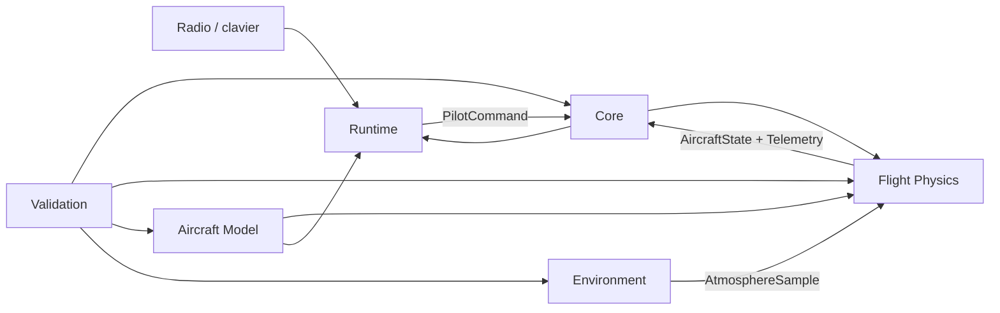

# Proposition de séparation du simulateur

## Organisation du travail

Le projet utilise un **contexte Base partagé** et trois chantiers spécialisés :

1. **Physique du vol**
2. **Modélisation des planeurs**
3. **Environnement et application**

La Base fixe les contrats communs. Elle ne choisit pas encore Unreal Engine, Godot, le solveur aérodynamique ou le format final des modèles.

## Principe directeur

Le simulateur ne doit pas confondre :

- le **modèle visuel** affiché par le moteur 3D ;
- la **description physique** utilisée pour calculer le vol ;
- les **conditions atmosphériques et le terrain** ;
- les **entrées du pilote** et l'interface utilisateur.

Ces composants communiquent par des contrats versionnés. On pourra ainsi remplacer le moteur 3D ou le solveur sans reconstruire tout le projet.

## Modules proposés

### 1. `core` — contrats et orchestration

Responsabilités :

- horloge de simulation et pas de calcul fixe ;
- état canonique du planeur : position, orientation, vitesses et accélérations ;
- commandes normalisées : ailerons, profondeur, direction, volets et aérofreins ;
- unités et repères de coordonnées ;
- événements : lancement, collision, réinitialisation et télémétrie ;
- chargement des configurations et versions de formats ;
- enregistrement/relecture déterministe d'un vol.

Le module `core` ne contient ni rendu 3D ni équations aérodynamiques propres à un planeur.

### 2. `flight-physics` — dynamique de vol

Responsabilités :

- intégration du corps rigide à six degrés de liberté ;
- forces et moments aérodynamiques ;
- masse, centre de gravité et tenseur d'inertie ;
- action des gouvernes ;
- interaction avec le vent transmis par l'environnement ;
- propulsion éventuelle ;
- contact avec le sol si ce choix est retenu ;
- calculs hors ligne : équilibre, polaires, finesse et taux de chute ;
- tests numériques et comparaison avec des mesures réelles.

Entrées : description physique du planeur, commandes, atmosphère locale et état précédent.

Sorties : nouvel état, forces, moments et télémétrie explicative.

### 3. `aircraft-model` — données et chaîne de création

Responsabilités :

- format source éditable du planeur ;
- géométrie de référence : ailes, empennages, profils et gouvernes ;
- modèle visuel, matériaux, niveaux de détail et pivots ;
- masse, centrage et inerties ;
- données aérodynamiques avec leur origine et domaine de validité ;
- import, validation et conversion vers le moteur physique et le moteur visuel ;
- paquet distribuable d'un planeur ;
- éditeur ou assistant d'import à terme.

Le format doit distinguer les valeurs **mesurées**, **calculées**, **estimées** et **non validées**.

### 4. `environment` — monde et aérologie

Responsabilités :

- terrain, relief et zones de collision ;
- atmosphère standard ;
- vent moyen, rafales et turbulence ;
- thermiques ;
- vent de pente calculé à partir du relief ;
- conditions météorologiques et scénarios ;
- points de lancement et zones de vol.

Le module expose au moteur physique un échantillon local : densité, température et vecteur du vent en fonction de la position et du temps.

### 5. `runtime` — rendu, radio et expérience utilisateur

Responsabilités :

- rendu 3D et caméras ;
- animation des gouvernes ;
- radio USB, calibration, courbes et mixages côté simulateur ;
- menus, télémétrie et aides de pilotage ;
- audio ;
- gestion des performances et interpolation visuelle ;
- packaging Windows.

Ce module consomme les sorties du `core`. Il ne recalcule pas une seconde physique de vol.

### 6. `validation` — outils transversaux

Responsabilités :

- scénarios reproductibles ;
- tests de stabilité numérique ;
- comparaison simulation/mesures ;
- graphiques de performances ;
- budgets CPU/GPU et mesure de latence des commandes ;
- rapports de confiance par domaine de vol.

Ce module peut être un ensemble d'outils et non une bibliothèque embarquée.

## Contrats à définir avant les technologies

### `AircraftPackage`

Contient au minimum : manifeste versionné, modèle visuel, masse, centrage, inerties, géométrie aérodynamique, gouvernes, données aérodynamiques, sources et domaine de validité.

### `PilotCommand`

Valeurs normalisées avec horodatage : roulis, tangage, lacet, volets, aérofreins, moteur et actions auxiliaires.

### `AircraftState`

Position, attitude, vitesses linéaires et angulaires, accélérations, temps simulé et état de contact.

### `AtmosphereSample`

Vent en trois dimensions, densité, température, pression et intensité de turbulence à une position et un instant donnés.

### `TelemetryFrame`

État synthétique plus contributions des forces et moments, afin de comprendre un comportement physique étrange.

## Dépendances autorisées

## Découpage des trois prompts spécialisés

Chaque prompt reçoit `BASE.md` comme contexte commun.

- **Physique** possède `flight-physics` et les tests numériques associés.
- **Modélisation** possède `aircraft-model`, ses schémas et convertisseurs.
- **Environnement** possède `environment` et propose aussi l'intégration dans `runtime` avec le moteur 3D retenu.

Les modifications de contrats dans `core` doivent être proposées explicitement et validées avant implémentation. Cela évite que les trois chantiers inventent des formats incompatibles.

## Ordre conseillé pour les prochains choix

1. Niveau de fidélité visé et phénomènes de vol à couvrir.
2. Architecture du moteur physique et méthode de validation.
3. Format source et paquet distribuable d'un planeur.
4. Moteur 3D et stratégie d'intégration.
5. Modèle de terrain et d'aérologie.
6. Première tranche verticale : un planeur, une pente, une radio, un protocole de mesure.

