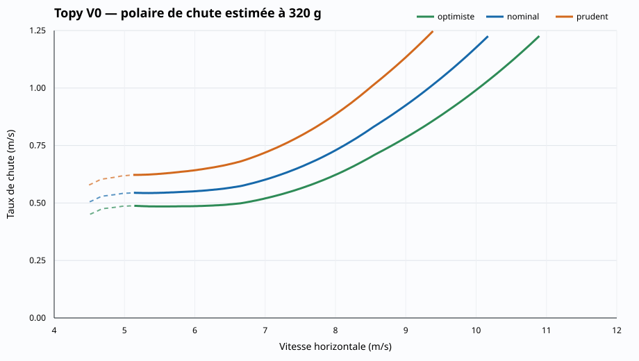

# Topy V0 — première analyse aérodynamique

**Statut : hypothèse calculée, non validée en vol.**

## Résultats

| Masse | Scénario | Finesse max. | Vitesse de finesse max. (m/s) | Chute mini. (m/s) | Vitesse de chute mini. (m/s) |
|---:|---|---:|---:|---:|---:|
| 0.320 | optimiste | 13.5 | 7.06 | 0.48 | 5.55 |
| 0.320 | nominal | 11.6 | 6.95 | 0.54 | 5.37 |
| 0.320 | prudent | 9.8 | 6.76 | 0.62 | 5.16 |
| 0.360 | optimiste | 13.8 | 7.41 | 0.50 | 6.04 |
| 0.360 | nominal | 11.9 | 7.30 | 0.57 | 5.70 |
| 0.360 | prudent | 10.0 | 7.10 | 0.65 | 5.16 |

### Estimation de la vitesse de décrochage

La géométrie tridimensionnelle et l'état de surface étant inconnus, `CLmax` est seulement encadré entre 1,05 et 1,25.

| Masse | avec CLmax 1,05 | avec CLmax 1,25 |
|---:|---:|---:|
| 0.320 kg | 4.85 m/s | 4.44 m/s |
| 0.360 kg | 5.14 m/s | 4.71 m/s |

Les traits pleins utilisent directement le domaine Reynolds mesuré. Les traits pointillés emploient la polaire à Reynolds 60 000 comme approximation en dessous de cette limite. Les valeurs de chute minimale du tableau sont limitées aux traits pleins.

## Méthode

- dimensions et masses : fiche publiée dans FMT 3/2000 ;
- traînée de profil : mesures UIUC du S4083 (A), interpolées selon `Cl` et le logarithme du Reynolds ;
- traînée induite : `CDi = CL² / (π e AR)` ;
- traînée du fuselage, de l'empennage et des interférences : coefficient forfaitaire explicite ;
- atmosphère : 1,225 kg/m³ et viscosité cinématique 1,5×10⁻⁵ m²/s ;
- calcul en vol plané stabilisé, sans vent.

| Scénario | Efficacité d'envergure `e` | Traînée supplémentaire `CD` |
|---|---:|---:|
| optimiste | 0,85 | 0,006 |
| nominal | 0,75 | 0,010 |
| prudent | 0,65 | 0,016 |

## Ce que ce test permet déjà

La chaîne de données fonctionne avec un profil mesuré au bon ordre de Reynolds. Elle fournit une première plage de vitesses et de performances pour initialiser les essais sans prétendre reproduire exactement l'appareil réel.

## Limites bloquant la validation

- le S4083 modifié n'est pas encore confirmé par un relevé de l'aile ;
- la modification fixe du bord de fuite n'est pas incluse ;
- la forme exacte en plan, le dièdre et le vrillage sont inconnus ;
- la traînée du fuselage et de l'empennage est estimée ;
- aucun équilibre de moment, centrage ou réglage de profondeur n'est calculé ;
- cette polaire statique ne prédit pas encore la maniabilité ni la stabilité dynamique.
- la zone de très basse vitesse passe sous Reynolds 60 000 ; elle reste affichée en pointillé mais n'est pas utilisée pour annoncer la chute minimale.

## Fichiers reproductibles

- `topy_v0_all_scenarios.csv` : tous les points calculés ;
- `topy_v0_nominal_320g.csv` : courbe nominale principale ;
- `topy_v0_metrics.json` : métriques résumées et hypothèses.

## Sources

- [Essai FMT 3/2000](https://rcbookcase.com/data/media/47/03FMT_March_2000.pdf)
- [Données de soufflerie UIUC, volume 2](https://m-selig.ae.illinois.edu/pd/pub/lsat/vol2/)
- [Fiche de conception du S4083](https://m-selig.ae.illinois.edu/ads/ref/s4083_ref.html)
